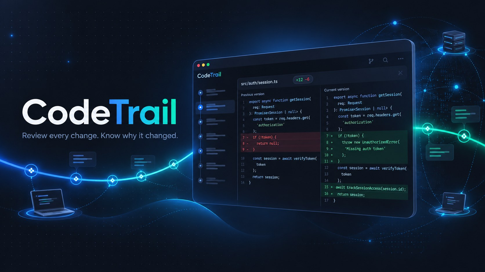
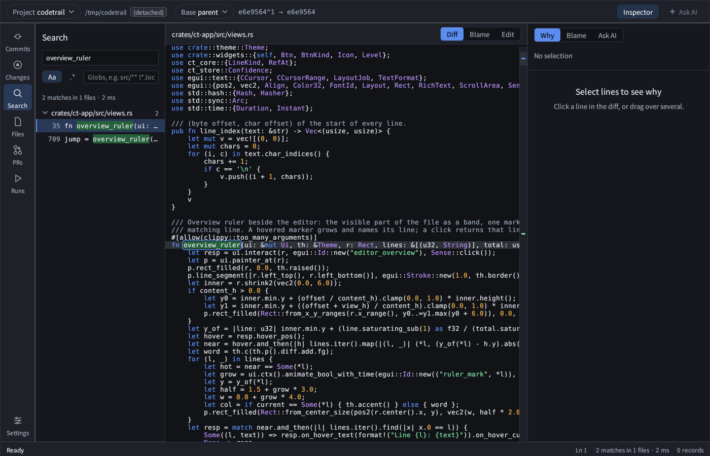
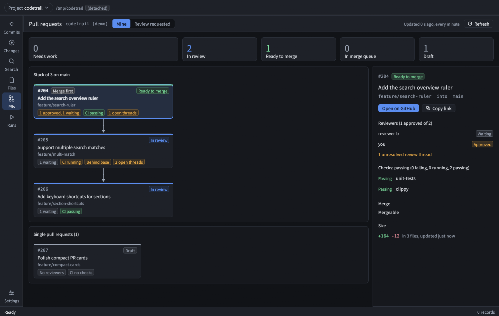
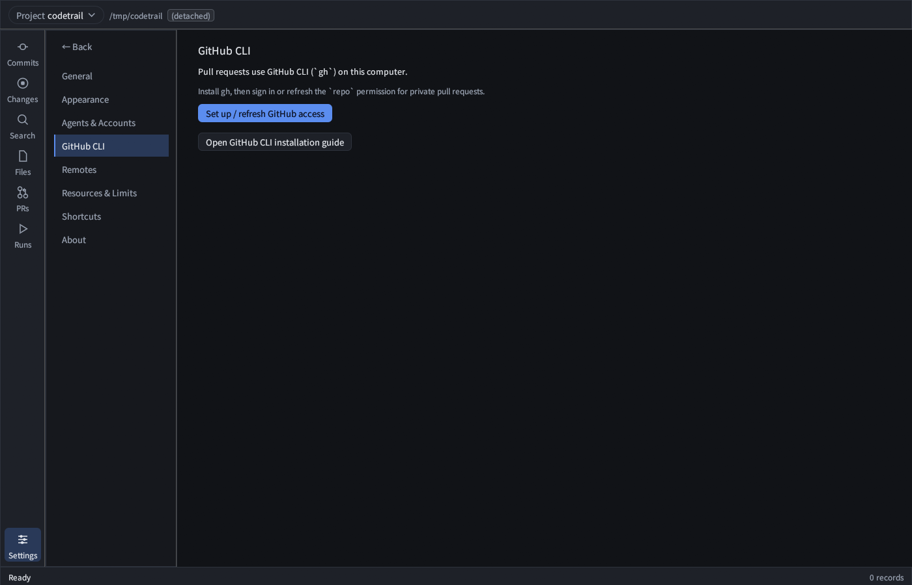

<p align="center"></p>

# codetrail

git 변경을 검토하고, AI 에이전트가 각 줄을 **왜** 바꿨는지 기록해 보여주는 가벼운 데스크톱 뷰어 (Rust + egui, Linux). 영문 원본: [README.md](README.md)



> `docs/screens/` 스크린샷은 CodeTrail 저장소 코드로 만들었습니다(`--smoke`). PR 화면의 PR·리뷰·체크 데이터는 가상 예시이며 실제 계정 데이터가 아닙니다.

### PR 스택



## 무엇인가

- **커밋 / 현재 변경 리뷰**: 커밋 목록, 파일 목록, unified/side-by-side diff. **Changes** 섹션은 staged / unstaged / untracked.
- **Pull requests**: `gh`로 내 열린 PR(또는 리뷰 요청받은 PR)을 1분마다 갱신. 상태 타일(작업 필요·리뷰 중·머지 가능·머지 큐·드래프트), base 브랜치 기준 스택, PR별 리뷰어 상태·CI·머지 상태. 내가 승인한 리뷰는 노란색으로 표시. PR 카드를 Ctrl+클릭하면 GitHub 링크를 열고, 일반 클릭은 카드를 선택합니다. `gh` 로그인이나 권한이 없으면 로그인 안내창을 띄우며 Settings > GitHub CLI에서도 설정할 수 있습니다.
- **자동 업데이트**: 시작 시 최신 릴리스 확인, 알림에서 한 번 클릭으로 받아 SHA-256 검증 후 교체·재시작 (.deb 시스템 설치는 릴리스 링크만).
- **Base 선택** (`Ctrl+B`): parent(기본), 이전 선택, 현재 변경(working tree), 임의 ref, merge-base.
- **AI 변경 이력 + 이유**: 에이전트 편집을 기록하고 **Why** 패널에 이유와 신뢰도를 표시. **Blame**으로 줄 이력 추적.
- **Ask AI**: 줄을 선택하고 `Ctrl+L` → 코드·diff·기록된 이유·질문을 Pi(ChatGPT/Copilot), Claude Code, Codex에 전달.
- **백그라운드 worktree 실행(Runs)**: 에이전트가 별도 worktree/브랜치에서 작업, 결과를 Apply(merge) 또는 Discard.
- **빠른 검색**: `Ctrl+P` 파일명, `Ctrl+Shift+F` 전체 텍스트.
- **경량**: 상태바에 RAM/CPU 표시.

## 설치

> 아래 패키징은 `dist/` 스크립트가 만드는 산출물을 기준으로 작성했으며, 이 문서 작성 시점에 **실행 검증하지 않았습니다**.

```
tar xzf codetrail-<ver>-linux-x86_64.tar.gz
cd codetrail-<ver>-linux-x86_64 && ./install.sh --prefix ~/.local
sudo apt install ./codetrail_<ver>_amd64.deb      # Debian/Ubuntu
```

소스: `cargo build --release -p ct-app` → `target/release/codetrail`.

런타임 의존: `git`, X11 또는 Wayland + OpenGL, 권장 `fonts-noto-cjk`(없으면 한글이 표시되지 않음). Pi 백엔드는 최초 1회 `npm` + 네트워크 필요.

## 빠른 시작

```
codetrail [/path/to/repo]
```

왼쪽 activity bar **Commits · Changes · Search · Files · PRs · Runs** (아래 Settings). 가운데 **Diff · Blame · Edit**, 오른쪽 인스펙터 **Why · Blame · Ask AI**. `j`/`k` 커밋 이동, `[`/`]` hunk 이동, `Ctrl+E` 편집, `Ctrl+S` 저장(1MB 초과·바이너리는 읽기 전용).

## 원격 저장소

다른 머신의 저장소 diff를 읽기 전용으로 봅니다: 설정 > Remotes > *Add remote*. Host 칸에서 Tailscale peer(`이름 — 100.x.y.z`)를 고르고 *User*에 그 호스트의 계정을 넣은 뒤 *Test connection*을 누르세요. 연결은 터미널의 `ssh user@host`와 같습니다(ssh-agent, 기본 키, `~/.ssh/config`). 비밀번호는 묻지 않으므로 `ssh`가 비밀번호를 요구하면 먼저 `ssh-copy-id user@host`를 실행하세요. 자세한 내용: [docs/REMOTE.md](docs/REMOTE.md).

## 에이전트 연동

```
codetrail install [--claude] [--omp] [--codex] [--dry-run]
```

플래그가 없으면 셋 모두. 멱등, 병합, 수정 전 백업. 건드리는 파일: Claude `~/.claude/settings.json`(Pre/PostToolUse/PostToolUseFailure/Stop 훅) + `~/.claude/skills/codetrail/SKILL.md`, omp `~/.agents/skills/codetrail/SKILL.md`, Codex `~/.codex/AGENTS.md`.

Claude Code는 훅이 자동 기록(항상 exit 0, 에이전트를 막지 않음). omp/Codex는 지침만 설치되며 에이전트가 `codetrail record --path <file> --agent <omp|codex>` 후 `codetrail note --record <id> --reason "<이유>"`를 실행.

기타: `codetrail export [--json]`, `codetrail record <id>`, `codetrail ask <path:L1-L2@rev> [--question Q] [--agent claude|omp|codex] [--print]`.

기록은 `<git_dir>/codetrail/log.ct`에 로컬로만 저장됩니다(git 이력 아님). `.git` 삭제/재클론 시 사라지므로 `codetrail export --json`으로 백업하세요. 비밀값처럼 보이는 부분은 `ask`에서 기본 제외됩니다.

## 계정과 모델

API 키는 저장하지 않습니다. **Pi**(ChatGPT, GitHub Copilot)는 codetrail이 `~/.local/share/codetrail/agent`에 설치하는 Pi 런타임의 OAuth. **Claude**는 공식 `claude` CLI 로그인(`claude auth login`)만 사용 — Anthropic 약관상 제3자 OAuth는 제공하지 않음: <https://code.claude.com/docs/en/legal-and-compliance>. **Codex**는 `codex login`.

PR 조회용 `gh` 로그인·권한은 Settings > GitHub CLI에서 설정할 수 있습니다. 조회 권한이 없으면 PR 화면에서도 로그인 안내창이 표시됩니다.



## Runs

- 에이전트는 `~/.local/share/codetrail/worktrees/…`의 별도 worktree, 브랜치 `ct/<slug>-<id>`에서 작업합니다.
- **worktree 격리는 보안 샌드박스가 아닙니다.** 에이전트는 사용자 권한으로 실행됩니다.
- Apply = 실행 결과 커밋의 `git merge --no-ff` (dirty tree·브랜치 이동 시 거부, 충돌 시 abort). Discard = worktree/브랜치 삭제.
- 한도: 동시 실행 `agent.max_concurrent`(기본 3), 실행당 RSS 3072MB·120분, 전체 6144MB(초과 시 Queued). 이 값들은 현재 `config.toml`로 바꿀 수 없습니다.
- 데이터: `~/.local/share/codetrail` (`$CT_DATA_DIR` 우선).

## 리소스 예산

GUI 유휴 CPU ≈0.6%, RSS 86–104MB(팀 테스트 보고 수치, 이 문서 작성 중 재측정하지 않음). git 동시 4개, 타임아웃 30초, 출력 64MiB 상한.

## 설정 / 단축키

`~/.config/codetrail/config.toml`, `theme.toml` (키 목록은 [README.md](README.md#configuration)). 섹션 이동은 `Ctrl+1` Commits, `Ctrl+2` Changes, `Ctrl+4` Files, `Ctrl+6` Runs, `Ctrl+Shift+P` PRs. 그 밖에 `Ctrl+P` 파일, `Ctrl+Shift+F` 검색, `Ctrl+K` 팔레트, `Ctrl+O` 프로젝트, `Ctrl+B` base, `Ctrl+E`/`Ctrl+S` 편집/저장, `Ctrl+G` 줄 이동, `Ctrl+L` Ask AI, `Ctrl+Shift+C` 코드 위치 복사. Ctrl 단축키는 Settings > Shortcuts에서 바꿀 수 있음 (`config.toml`의 `[keys]`).

## 문제 해결

- 모델이 안 보임: 로그인 여부, `claude`/`codex` CLI 설치, Pi 런타임 설치(`npm` + 네트워크) 확인.
- 훅 타임아웃 5초: 느려도 에이전트는 막히지 않으며 해당 편집이 기록되지 않을 수 있음.
- 한글이 네모로 보임: `fonts-noto-cjk` 설치 후 재시작.

## 알려진 제한

한글 IME 입력 미검증(표시는 검증), 비 UTF-8 경로는 손실 표시, combined merge diff 미지원, 재시작 시 실행 중이던 run의 라이브 출력 소실, Pi 0.74.2는 완료 이벤트가 없어 400ms 정적 구간으로 완료 판단, Linux만 검증.

## 제거

`./uninstall.sh --prefix <같은 경로>` 또는 `sudo apt remove codetrail`. 데이터는 남으므로 필요 시 `rm -rf ~/.config/codetrail ~/.local/share/codetrail`. 에이전트 훅/skill은 `~/.claude`, `~/.agents`, `~/.codex`에서 수동 제거.

## 개발

`cargo test --workspace`, `codetrail --smoke <repo> --screenshot out.png --scene <name>`. 라이브 테스트는 `CT_LIVE=1` 등 환경변수로만 실행. 크레이트 설명은 [README.md](README.md#development).
